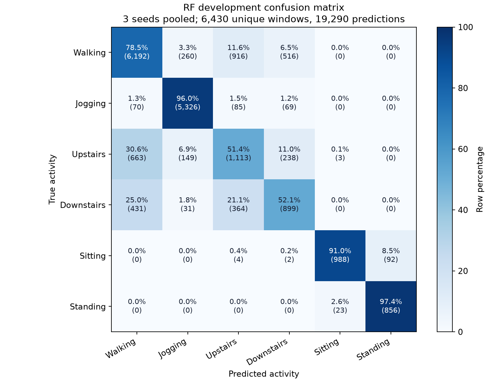
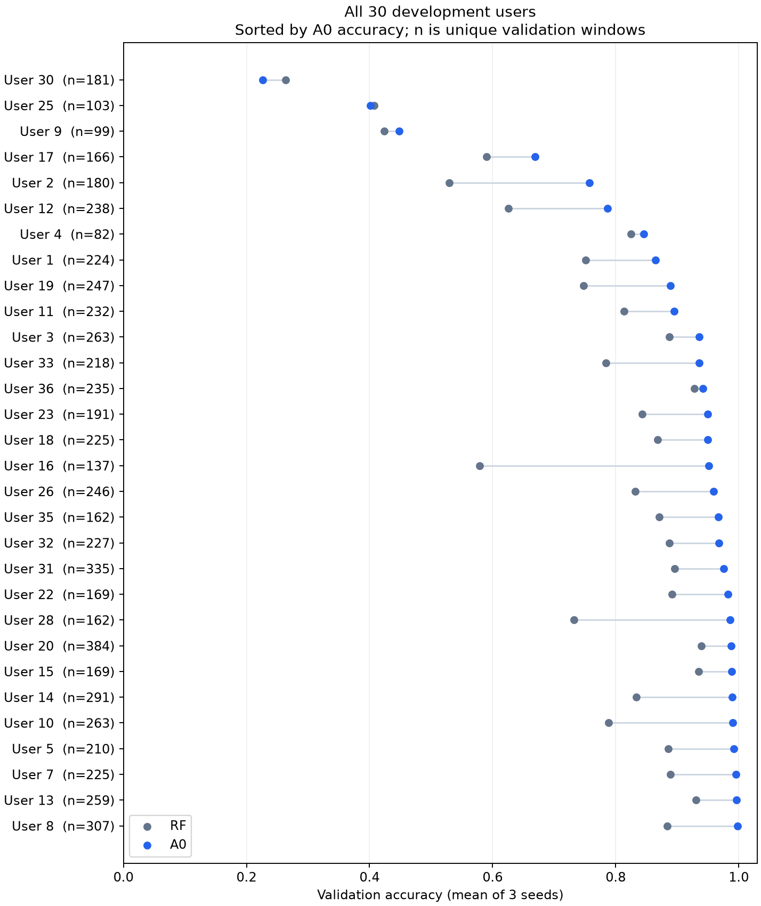
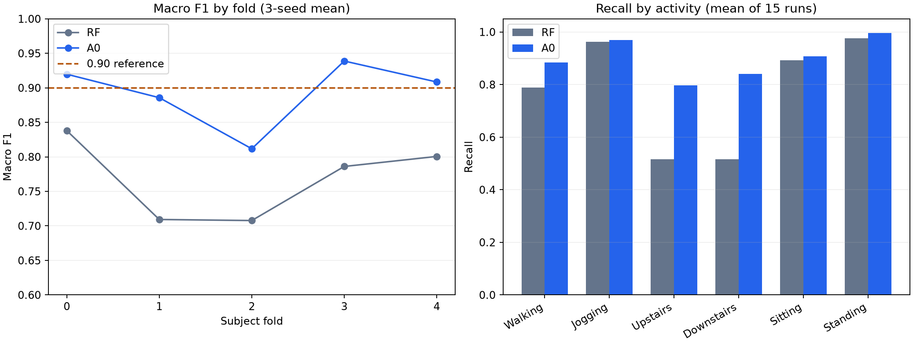

# WISDM Random Forest 참조선 연구보고서

작성일 2026년 11월 16일 · 기계학습프로그래밍 · 개발 사용자 독립 검증 결과

## 1 연구 목적과 주요 결론

CNN의 비교 기준으로, 가속도 윈도우에서 통계 특징을 추출한 Random Forest를 평가했다. 동일한 사용자 분할에서 **Macro F1 0.7683 ± 0.0578, Accuracy 0.7946**를 얻었다. Jogging·Standing은 비교적 잘 구분하지만 계단 두 행동의 Recall은 각각 약 0.52로 낮다. A0보다 모든 fold에서 Macro F1이 낮아, 이후 CNN 구성 요소 실험에서 외부 참조선 역할을 한다. 이 결과는 별도 논문의 RF 점수나 최종 테스트 성능과 직접 동일시하지 않는다.

## 2 데이터와 평가 설계

WISDM v1.1 raw의 휴대폰 3축 가속도 시계열을 사용했다. 사용자 36명이 수행한 6개 행동을 분류하며, 샘플링 주파수는 약 20 Hz이다. 입력 윈도우는 128개 시점으로 약 6.4초에 해당한다. 실제 사용자의 이름 대신 공개 데이터의 숫자 ID를 사용한다.

정제는 timestamp 0 삭제, 완전히 같은 레코드 삭제, 연속된 동일 사용자·행동·시각의 뒤 레코드 제외 순서로 적용했다. 사용자·행동 변경, 파싱 실패, 시간 역행, 1초 초과 공백에서 연속 구간을 끊고 128개보다 짧은 구간은 제외했다. 현재 확정 코드의 결과는 **424개 구간, 겹치지 않는 윈도우 7,841개**이다. 원본 중복 66,820건과 timestamp 0인 12,845건은 서로 겹칠 수 있어 단순히 합산해 제거량으로 해석하지 않는다.

| 행동 | 전체 정제 윈도우 | 개발 검증 윈도우 |
| --- | --- | --- |
| Walking | 3146 | 2628 |
| Jogging | 2333 | 1850 |
| Upstairs | 867 | 722 |
| Downstairs | 705 | 575 |
| Sitting | 433 | 362 |
| Standing | 357 | 293 |

테스트 사용자 **6, 21, 24, 27, 29, 34번**의 1,411개 윈도우는 최종 평가용으로 보류했다. 나머지 30명을 6명씩 5개 fold로 나누고, 매회 학습 24명과 검증 6명이 겹치지 않게 했다. 학습 stride는 64, 검증 stride는 128이다. 따라서 학습에는 절반 겹치는 윈도우가 있지만 검증에는 동일 구간 내 겹침이 없다. 서로 다른 fold의 학습 윈도우 수를 합해 고유 표본 수라고 보고하지 않는다.

| fold | 학습 사용자 수 | 학습 윈도우 수 | 검증 사용자 수 | 검증 윈도우 수 |
| --- | --- | --- | --- | --- |
| 0 | 24 | 10041 | 6 | 1340 |
| 1 | 24 | 10499 | 6 | 1109 |
| 2 | 24 | 10049 | 6 | 1332 |
| 3 | 24 | 9798 | 6 | 1468 |
| 4 | 24 | 10353 | 6 | 1181 |

개발 검증의 고유 윈도우는 총 **6,430개**이다. seed 0, 1, 2로 각각 반복하므로 총 검증 예측은 **19,290건**이지만, 이를 독립적인 데이터 19,290개로 해석하지 않는다. 17명은 일부 행동이 없고 Sitting·Standing 보유자는 각각 23명·24명으로, 사용자별 행동 구성과 표본 수의 차이가 남아 있다.
## 3 특징 추출과 데이터 학습

각 윈도우의 x·y·z축과 합성 가속도 크기로 4개 시계열을 구성한다. 각 시계열에서 평균, 표준편차, 평균 절대편차, 최솟값, 최댓값, 중앙값, 10·25·75·90 백분위수, 인접 차분의 평균 절댓값 등 11개 통계량을 얻는다. 44개 값에 xy·xz·yz의 상관계수 3개를 더해 **47개 특징**을 입력한다.

이 RF 구현은 축별 표준화를 적용하지 않고 원래 값에서 특징을 추출한다. A0와 원본 데이터·정제·윈도우·분할은 같지만 입력 표현과 스케일 처리는 다르다. 인접 차분 통계는 시간 변화의 일부를 반영하므로 RF가 시간 정보를 전혀 사용하지 않는다고 표현하지 않는다.

| 학습 항목 | 설정 |
|---|---|
| 분류기 | scikit-learn RandomForestClassifier |
| 트리 수 | 300 |
| 분할 기준 | Gini |
| max depth | 제한 없음 |
| max features | sqrt |
| bootstrap | 사용 |
| min samples split과 leaf | 2와 1 |
| class weight | 사용하지 않음 |
| 병렬 작업 | n_jobs 4 |
| random state | seed 0 1 2 |
| 실행 | 로컬 PC CPU |

RF는 CNN처럼 epoch·learning rate·역전파 loss로 학습하지 않는다. 고정된 설정으로 학습 표본에 300개의 트리를 적합한 후 검증했다. 별도의 하이퍼파라미터 탐색이나 검증점수 기반 조기 종료는 적용하지 않았다. 최초 정식 실행의 학습시간은 평균 **7.8초**, 합계 **116.8초**였다. 원래 훈련 정확도·트리 수별 학습 곡선은 저장하지 않았으므로 검증 점수만으로 과적합 정도를 확정하지 않는다.

상세 분류지표를 작성하기 위해 2026년 11월 16일 동일 코드·분할·seed·설정으로 15회를 재실행했다. 현재 복원 환경은 Python 3.14.2, scikit-learn 1.9.1이며, **기존 Accuracy·Macro F1·행동별 Recall·사람별 정확도가 모두 일치**했다. 최초 실행 파일은 덮어쓰지 않았다. 아래 Precision·행동별 F1·혼동행렬은 이 일치 검증을 통과한 복원 예측으로 계산했다. 집계 점수의 일치가 원래 개별 예측 하나하나의 동일성을 직접 증명하는 것은 아니다.

## 4 전체 분류지표

### 지표를 읽는 방법

- Accuracy는 전체 윈도우 중 맞힌 비율이다.
- Precision은 특정 행동으로 예측한 것 중 실제로도 그 행동인 비율, Recall은 실제 그 행동 중 찾아낸 비율이다.
- F1은 Precision과 Recall의 조화평균이다. Macro F1은 6개 행동의 F1을 같은 비중으로 평균하고, Weighted F1은 각 행동의 실제 표본 수를 가중치로 사용한다. Macro F1을 추가 정답 개수나 Accuracy 차이로 환산하지 않는다.
- 주 결과는 각 fold 안에서 seed 3개를 먼저 평균한 뒤 fold 5개의 평균과 표준편차로 보고한다. 표준편차는 fold에 포함된 사람 조합에 따른 변동이며 신뢰구간이나 유의확률이 아니다.
- 행동별 표의 Precision·Recall·F1은 15회 지표의 평균이다. 마지막 열은 seed 반복을 제거한 개발 윈도우 수다. 혼동행렬은 15회 예측을 합산하므로 표와 집계 방식이 다르며, 행 비율이 행동별 표의 평균 Recall과 정확히 같지는 않다.

| 지표 | fold 평균 | fold 표준편차 |
| --- | --- | --- |
| Accuracy | 0.7946 | 0.0589 |
| Macro Precision | 0.7706 | 0.0549 |
| Macro Recall | 0.7751 | 0.0534 |
| Macro F1 | 0.7683 | 0.0578 |
| Weighted F1 | 0.7978 | 0.0523 |

Macro F1이 0.90 이상인 fold는 **0/5**다. 전체 개발 예측을 합친 보조 지표는 Accuracy 0.7970, Macro F1 0.7720다. 주 결과인 fold 평균과 섞어 비교하지 않는다.

## 5 행동별 분류지표와 오류

| 행동 | Precision | Recall | F1 | 개발 윈도우 수 |
| --- | --- | --- | --- | --- |
| Walking 걷기 | 0.8452 | 0.7891 | 0.8138 | 2,628 |
| Jogging 조깅 | 0.9277 | 0.9623 | 0.9440 | 1,850 |
| Upstairs 계단 오르기 | 0.4611 | 0.5158 | 0.4748 | 722 |
| Downstairs 계단 내려가기 | 0.5200 | 0.5160 | 0.5160 | 575 |
| Sitting 앉기 | 0.9596 | 0.8920 | 0.9222 | 362 |
| Standing 서기 | 0.9101 | 0.9752 | 0.9393 | 293 |

Jogging과 Standing의 높은 Recall만으로 전체 분류가 잘 된다고 판단할 수 없다. Upstairs와 Downstairs는 절반가량을 놓치며, 행동별 표본 수가 다른 상황에서 Accuracy보다 Macro F1을 함께 보는 이유가 드러난다.

행은 실제 행동, 열은 예측 행동이다. 비율은 행별로 계산했으며 괄호는 seed 3개 합산 예측 건수다. 아래는 가장 큰 오류 방향이다.

| 실제 행동 | 예측 행동 | 오류 수 | 전체 오류 내 비중 |
| --- | --- | --- | --- |
| Walking | Upstairs | 916 | 23.4% |
| Upstairs | Walking | 663 | 16.9% |
| Walking | Downstairs | 516 | 13.2% |
| Downstairs | Walking | 431 | 11.0% |
| Downstairs | Upstairs | 364 | 9.3% |

오류가 반복되는 방향은 현재 특징 표현이 일부 이동 동작을 충분히 나누지 못함을 보여준다. 그러나 이 자료만으로 단일 원인이 시간 순서 손실이라고 단정하지 않는다. 특징 선택·모델 설정·사용자 간 신호 차이가 함께 영향을 줄 수 있다.

## 6 fold와 사용자에 따른 차이

| fold | 검증 사용자 | Accuracy | Macro F1 | seed 간 F1 표준편차 |
| --- | --- | --- | --- | --- |
| 0 | 1, 7, 20, 22, 25, 36 | 0.8505 | 0.8380 | 0.0018 |
| 1 | 9, 16, 19, 26, 28, 33 | 0.7217 | 0.7093 | 0.0108 |
| 2 | 2, 3, 4, 14, 30, 31 | 0.7407 | 0.7077 | 0.0081 |
| 3 | 8, 10, 11, 12, 13, 15 | 0.8279 | 0.7861 | 0.0033 |
| 4 | 5, 17, 18, 23, 32, 35 | 0.8321 | 0.8006 | 0.0064 |

| 사용자 | fold | 윈도우 수 | 평균 Accuracy | seed 표준편차 |
| --- | --- | --- | --- | --- |
| 30 | 2 | 181 | 0.2634 | 0.0032 |
| 25 | 0 | 103 | 0.4078 | 0.0000 |
| 9 | 1 | 99 | 0.4242 | 0.0101 |
| 2 | 2 | 180 | 0.5296 | 0.0794 |
| 16 | 1 | 137 | 0.5791 | 0.0235 |
| 17 | 4 | 166 | 0.5904 | 0.0181 |

사용자별 같은 비중의 평균 Accuracy는 **0.7688**다. 같은 fold 안에서 seed만 바꾼 편차보다 fold 사이의 Macro F1 표준편차가 더 크다. 점수가 특정 seed보다 검증 사용자 조합의 영향을 많이 받는다는 관측이며, 이것이 평가가 잘못됐다는 뜻은 아니다. 모델 간에는 같은 fold끼리 짝지어 비교한다.

사용자 25번의 어려움은 RF와 A0 모두에 나타난다. 어떤 사람을 제외하면 점수가 좋아진다는 이유로 제외하지 않는다. 원본 신호나 라벨에 명확한 오류가 확인되면 그때 별도의 정제 근거와 영향 분석을 남긴다.

## 7 A0 CNN과 비교

| fold | RF Macro F1 | A0 Macro F1 | 차이 %p |
| --- | --- | --- | --- |
| 0 | 0.8380 | 0.9197 | +8.18 |
| 1 | 0.7093 | 0.8857 | +17.65 |
| 2 | 0.7077 | 0.8117 | +10.40 |
| 3 | 0.7861 | 0.9388 | +15.27 |
| 4 | 0.8006 | 0.9085 | +10.79 |

A0는 RF보다 Macro F1이 평균 **12.46%p** 높고 모든 fold에서 개선됐다. 계단 동작의 Recall 개선도 확인된다. 그러나 RF의 특징 입력과 CNN의 원시 시계열 입력이 달라 순수한 알고리즘 하나의 효과로 분리할 수 없으며, RF는 검증을 통한 epoch 선택을 하지 않는다는 차이도 있다.

RF는 동일 조건의 비교 참조선으로 유지한다. 현재 결과를 보고 RF 설정만 추가로 조정해 기존 결과와 섞지 않는다. RF 개선 실험을 한다면 별도 실험명과 사전 설정을 부여한다.

## 8 한계와 다음 활용

47개 통계 특징과 300개 트리라는 한 구현의 결과다. 더 풍부한 주파수 특징이나 다른 RF 설정의 상한을 뜻하지 않는다. 훈련 점수·학습 곡선을 저장하지 않아 훈련과 검증 사이의 차이를 직접 평가할 수 없고, 최초 실행의 상세 라이브러리 버전은 별도로 남아 있지 않다. 복원 환경과 최초 실행 환경을 같은 것으로 단정하지 않는다.

외부 논문에서 언급된 RF 0.87과는 WISDM 버전·사람 분할·지표가 같은지 확인되지 않았으므로 직접 우열을 비교하지 않는다. 최종 테스트 6명도 평가하지 않았다. CPU 추론시간과 메모리 사용량은 아직 측정하지 않았고, PC와 T4의 학습시간으로 효율 우열을 판단하지 않는다.

A1 이후 CNN 비교에서는 RF를 고정된 참조선으로 유지한다. 개발 결과로 최종 후보가 결정되면 RF도 개발 30명 전체로 다시 학습한 뒤 동일한 보류 테스트에 평가한다.

## 9 최초 정식 실행별 기록

| fold | seed | Accuracy | Macro F1 | 학습 초 |
| --- | --- | --- | --- | --- |
| 0 | 0 | 0.8493 | 0.8369 | 7.6 |
| 0 | 1 | 0.8515 | 0.8400 | 7.5 |
| 0 | 2 | 0.8507 | 0.8371 | 7.5 |
| 1 | 0 | 0.7133 | 0.6976 | 7.7 |
| 1 | 1 | 0.7394 | 0.7188 | 7.7 |
| 1 | 2 | 0.7124 | 0.7114 | 7.5 |
| 2 | 0 | 0.7395 | 0.7067 | 7.5 |
| 2 | 1 | 0.7530 | 0.7163 | 7.5 |
| 2 | 2 | 0.7297 | 0.7002 | 7.5 |
| 3 | 0 | 0.8304 | 0.7896 | 8.0 |
| 3 | 1 | 0.8256 | 0.7831 | 7.9 |
| 3 | 2 | 0.8277 | 0.7856 | 8.1 |
| 4 | 0 | 0.8417 | 0.8065 | 8.2 |
| 4 | 1 | 0.8332 | 0.8015 | 8.4 |
| 4 | 2 | 0.8213 | 0.7939 | 8.2 |
## 10 근거 자료와 재현 방법

- [연구계획서](../연구계획서.md)와 [데이터 출처 설명](../artifacts/source_descriptions.json)
- 데이터 출처에서 요청한 인용 문헌은 Jennifer R. Kwapisz, Gary M. Weiss, Samuel A. Moore의 2010년 논문 *Activity Recognition using Cell Phone Accelerometers*이다. 문헌 서지는 데이터셋 README를 기준으로 기록했다.
- 지표 정의는 [scikit-learn classification_report](https://scikit-learn.org/stable/modules/generated/sklearn.metrics.classification_report.html), 혼동행렬의 행과 열 정의는 [confusion_matrix](https://scikit-learn.org/stable/modules/generated/sklearn.metrics.confusion_matrix)를 따른다.
- 아래 연결된 원시 결과와 보고서용 상세 표에는 반올림 전 수치가 있다. 보고서의 4자리 표시는 가독성을 위한 반올림이다.

- [RF 학습 노트북](../03R_RandomForest_참조선_5fold.ipynb)
- [최초 실행별 결과](../runs/RF_runs.csv), [최초 사람별 결과](../runs/RF_users.csv), [복원 환경과 일치 검증 기록](../runs/RF_reproduction.json)
- [추가 분류지표 원자료](RF_classification_runs.csv), [행동별 지표 원자료](RF_classification_by_class.csv), [사용자 전체 요약](RF_users_summary.csv), [혼동행렬 건수](RF_confusion_counts.csv)
- 복원 예측은 `../runs/RF_fold{fold}_seed{seed}_predictions.npz`에 저장했다. 복원 학습시간은 위 최초 실행 시간과 분리해 `RF_reproduction.json`에 보존했다.
