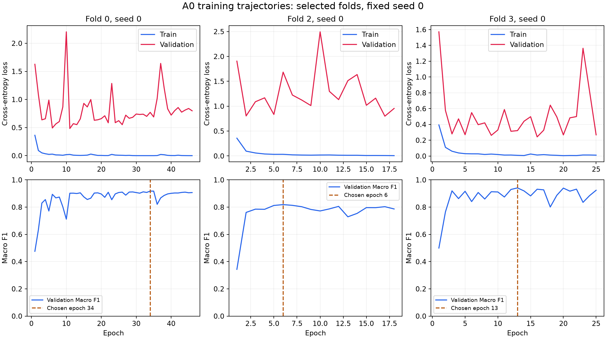
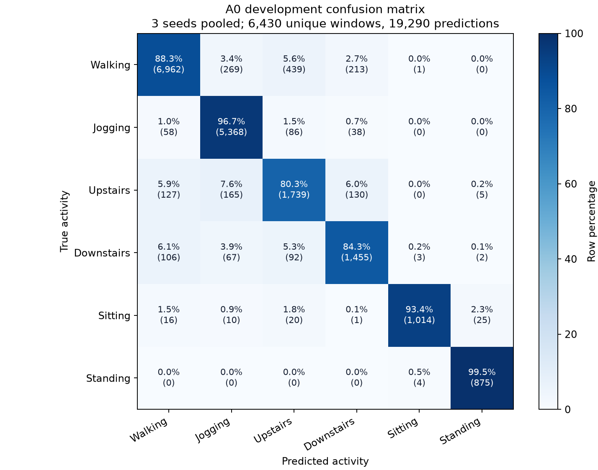
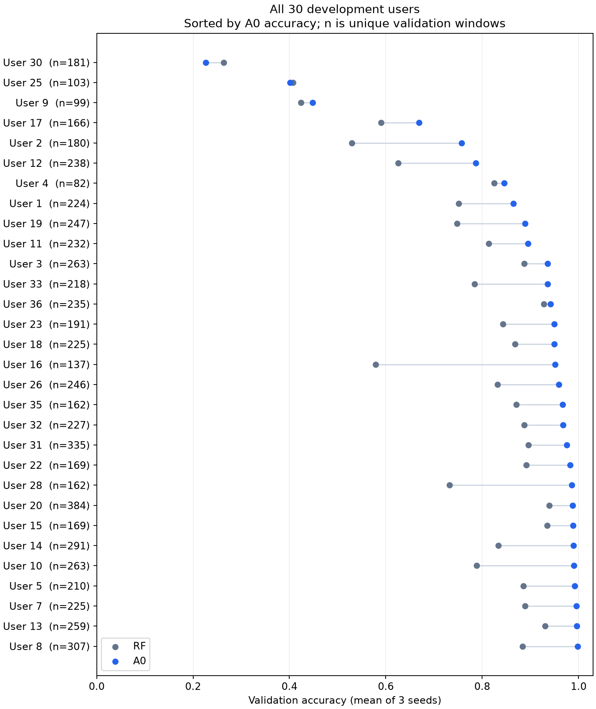
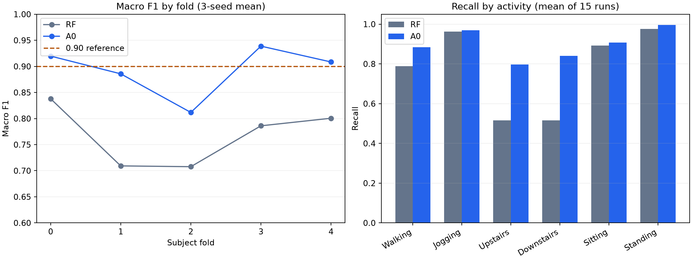

# WISDM A0 기본 CNN 연구보고서

작성일 2026년 11월 16일 · 기계학습프로그래밍 · 개발 사용자 독립 검증 결과

## 1 연구 목적과 주요 결론

원시 가속도 시계열을 입력으로 사용하는 기본 CNN을 학습하고, 이후 Residual·Inception·Attention·Depthwise 실험을 비교할 기준점을 확보했다. 정식 5-fold × 3-seed 결과는 **Macro F1 0.8929 ± 0.0493, Accuracy 0.9021**이다. RF 참조선보다 Macro F1이 평균 **12.46%p 높고 5개 fold 모두 개선**됐으나, 주 지표의 평균은 사전 참고선 0.90에 조금 못 미쳤다. 사용자 30·25·9번과 계단 동작에서 개선 여지가 크다. 이 보고서의 수치는 최종 테스트 성능이 아니다.

## 2 데이터와 평가 설계

WISDM v1.1 raw의 휴대폰 3축 가속도 시계열을 사용했다. 사용자 36명이 수행한 6개 행동을 분류하며, 샘플링 주파수는 약 20 Hz이다. 입력 윈도우는 128개 시점으로 약 6.4초에 해당한다. 실제 사용자의 이름 대신 공개 데이터의 숫자 ID를 사용한다.

정제는 timestamp 0 삭제, 완전히 같은 레코드 삭제, 연속된 동일 사용자·행동·시각의 뒤 레코드 제외 순서로 적용했다. 사용자·행동 변경, 파싱 실패, 시간 역행, 1초 초과 공백에서 연속 구간을 끊고 128개보다 짧은 구간은 제외했다. 현재 확정 코드의 결과는 **424개 구간, 겹치지 않는 윈도우 7,841개**이다. 원본 중복 66,820건과 timestamp 0인 12,845건은 서로 겹칠 수 있어 단순히 합산해 제거량으로 해석하지 않는다.

| 행동 | 전체 정제 윈도우 | 개발 검증 윈도우 |
| --- | --- | --- |
| Walking | 3146 | 2628 |
| Jogging | 2333 | 1850 |
| Upstairs | 867 | 722 |
| Downstairs | 705 | 575 |
| Sitting | 433 | 362 |
| Standing | 357 | 293 |

테스트 사용자 **6, 21, 24, 27, 29, 34번**의 1,411개 윈도우는 최종 평가용으로 보류했다. 나머지 30명을 6명씩 5개 fold로 나누고, 매회 학습 24명과 검증 6명이 겹치지 않게 했다. 학습 stride는 64, 검증 stride는 128이다. 따라서 학습에는 절반 겹치는 윈도우가 있지만 검증에는 동일 구간 내 겹침이 없다. 서로 다른 fold의 학습 윈도우 수를 합해 고유 표본 수라고 보고하지 않는다.

| fold | 학습 사용자 수 | 학습 윈도우 수 | 검증 사용자 수 | 검증 윈도우 수 |
| --- | --- | --- | --- | --- |
| 0 | 24 | 10041 | 6 | 1340 |
| 1 | 24 | 10499 | 6 | 1109 |
| 2 | 24 | 10049 | 6 | 1332 |
| 3 | 24 | 9798 | 6 | 1468 |
| 4 | 24 | 10353 | 6 | 1181 |

개발 검증의 고유 윈도우는 총 **6,430개**이다. seed 0, 1, 2로 각각 반복하므로 총 검증 예측은 **19,290건**이지만, 이를 독립적인 데이터 19,290개로 해석하지 않는다. 17명은 일부 행동이 없고 Sitting·Standing 보유자는 각각 23명·24명으로, 사용자별 행동 구성과 표본 수의 차이가 남아 있다.
## 3 모델 구성과 데이터 학습

입력은 `(윈도우 수, 128, 3)`이다. 각 fold의 학습 사용자 24명에게서만 축별 평균·표준편차를 계산하고, 그 값으로 학습·검증 데이터를 표준화했다. 검증 사용자나 테스트 사용자로 표준화 통계를 맞추지 않았다.

구조는 `Conv1D 64채널 → 두 개의 CNN 블록 → GlobalAveragePooling → Dropout → 6클래스 Softmax`이다. 각 블록은 kernel 5인 Conv1D 두 개와 BatchNormalization·ReLU를 사용하고 마지막에 MaxPool 2를 적용한다. A0에는 residual 더하기나 attention이 없다. 총 파라미터는 **84,870개**, 그중 학습 가능한 파라미터는 84,230개이다.

| 학습 항목 | 설정 |
|---|---|
| Optimizer | Adam, learning rate 0.001 |
| 손실함수 | Sparse categorical cross entropy |
| Batch size | 64 |
| 최대 epoch | 100 |
| Dropout | 0.4 |
| 조기 종료 | 검증 Macro F1, patience 12 |
| 가중치 선택 | 검증 Macro F1 최고 epoch의 가중치 복원 |
| 반복 | 5 fold × seed 0 1 2 |
| 실행 환경 | Colab T4 GPU, TensorFlow 2.21.0, NumPy 2.4.6 |

15회 모두 조기 종료됐고 종료 epoch는 17~53, 선택 epoch는 5~41이었다. 학습시간은 합계 **707.6초**, 평균 **47.2초**, 최소 27.6초·최대 76.5초다. 이 값은 `model.fit` 구간으로 데이터 읽기·전송·결과 저장 시간을 제외한다.

위 그림은 fold 0·2·3의 seed 0을 보여준다. 위쪽은 훈련·검증 loss, 아래쪽은 검증 Macro F1과 선택 epoch다. 훈련 loss가 낮아져도 검증 loss가 함께 감소하지 않는 구간이 나타난다. 이를 일반화의 한계로 보되, 검증 loss 증가와 Macro F1 하락이 반드시 동시에 발생하는 것은 아니다. epoch 선택 기준을 결과를 보고 val loss로 바꾸지 않았다. 전체 15회 곡선의 원자료는 보존했다.

## 4 전체 분류지표

### 지표를 읽는 방법

- Accuracy는 전체 윈도우 중 맞힌 비율이다.
- Precision은 특정 행동으로 예측한 것 중 실제로도 그 행동인 비율, Recall은 실제 그 행동 중 찾아낸 비율이다.
- F1은 Precision과 Recall의 조화평균이다. Macro F1은 6개 행동의 F1을 같은 비중으로 평균하고, Weighted F1은 각 행동의 실제 표본 수를 가중치로 사용한다. Macro F1을 추가 정답 개수나 Accuracy 차이로 환산하지 않는다.
- 주 결과는 각 fold 안에서 seed 3개를 먼저 평균한 뒤 fold 5개의 평균과 표준편차로 보고한다. 표준편차는 fold에 포함된 사람 조합에 따른 변동이며 신뢰구간이나 유의확률이 아니다.
- 행동별 표의 Precision·Recall·F1은 15회 지표의 평균이다. 마지막 열은 seed 반복을 제거한 개발 윈도우 수다. 혼동행렬은 15회 예측을 합산하므로 표와 집계 방식이 다르며, 행 비율이 행동별 표의 평균 Recall과 정확히 같지는 않다.

| 지표 | fold 평균 | fold 표준편차 |
| --- | --- | --- |
| Accuracy | 0.9021 | 0.0432 |
| Macro Precision | 0.8990 | 0.0314 |
| Macro Recall | 0.8991 | 0.0601 |
| Macro F1 | 0.8929 | 0.0493 |
| Weighted F1 | 0.9041 | 0.0430 |

Macro F1이 0.90 이상인 fold는 **3/5**다. Accuracy만 보고 목표에 도달했다고 결론내리지 않는다. 모든 개발 예측을 합친 보조 지표는 Accuracy 0.9027, Macro F1 0.8971이며, 사람·표본 비중이 달라 주 결과인 fold 평균과 구분한다.

## 5 행동별 분류지표와 오류

| 행동 | Precision | Recall | F1 | 개발 윈도우 수 |
| --- | --- | --- | --- | --- |
| Walking 걷기 | 0.9564 | 0.8839 | 0.9176 | 2,628 |
| Jogging 조깅 | 0.9227 | 0.9695 | 0.9441 | 1,850 |
| Upstairs 계단 오르기 | 0.7471 | 0.7967 | 0.7621 | 722 |
| Downstairs 계단 내려가기 | 0.8122 | 0.8406 | 0.8150 | 575 |
| Sitting 앉기 | 0.9852 | 0.9079 | 0.9365 | 362 |
| Standing 서기 | 0.9704 | 0.9958 | 0.9824 | 293 |

Standing과 Jogging은 Recall이 높고, Upstairs·Downstairs는 상대적으로 낮다. 특히 Upstairs는 Precision도 낮아 다른 행동이 Upstairs로 잘못 들어오는 오류가 함께 존재한다.

행은 실제 행동, 열은 예측 행동이다. 각 칸의 위 숫자는 실제 행동 기준 비율이고 괄호는 seed 3개를 포함한 예측 건수다. 아래 표는 정답 대각선을 제외한 큰 오류 방향이다.

| 실제 행동 | 예측 행동 | 오류 수 | 전체 오류 내 비중 |
| --- | --- | --- | --- |
| Walking | Upstairs | 439 | 23.4% |
| Walking | Jogging | 269 | 14.3% |
| Walking | Downstairs | 213 | 11.3% |
| Upstairs | Jogging | 165 | 8.8% |
| Upstairs | Downstairs | 130 | 6.9% |

걷기와 계단 동작의 혼동이 주요 오류다. 앉기와 서기의 구분만을 핵심 병목으로 간주했던 UCI HAR 분석을 WISDM에 그대로 적용하지 않는다. 이동 동작의 오류가 줄어드는지 후속 구조에서 확인해야 한다.

## 6 fold와 사용자에 따른 차이

| fold | 검증 사용자 | Accuracy | Macro F1 | seed 간 F1 표준편차 |
| --- | --- | --- | --- | --- |
| 0 | 1, 7, 20, 22, 25, 36 | 0.9147 | 0.9197 | 0.0063 |
| 1 | 9, 16, 19, 26, 28, 33 | 0.8963 | 0.8857 | 0.0038 |
| 2 | 2, 3, 4, 14, 30, 31 | 0.8313 | 0.8117 | 0.0085 |
| 3 | 8, 10, 11, 12, 13, 15 | 0.9446 | 0.9388 | 0.0021 |
| 4 | 5, 17, 18, 23, 32, 35 | 0.9235 | 0.9085 | 0.0136 |

| 사용자 | fold | 윈도우 수 | 평균 Accuracy | seed 표준편차 |
| --- | --- | --- | --- | --- |
| 30 | 2 | 181 | 0.2265 | 0.0577 |
| 25 | 0 | 103 | 0.4013 | 0.0112 |
| 9 | 1 | 99 | 0.4478 | 0.0154 |
| 17 | 4 | 166 | 0.6687 | 0.0652 |
| 2 | 2 | 180 | 0.7574 | 0.1964 |
| 12 | 3 | 238 | 0.7871 | 0.0170 |

30명에게 같은 비중을 준 평균 Accuracy는 **0.8740**다. 윈도우 수가 다른 사용자들을 함께 계산한 fold 평균 Accuracy와 의미가 다르다. 30번은 Walking 예측 261건 중 236건을 Jogging으로 분류했다. 사용자 25번도 Walking을 거의 구분하지 못한다. 이는 확인된 오류 패턴이며 휴대폰 방향·걸음걸이·센서 이상 중 어느 요인 때문인지는 추가 분석 없이 단정하지 않는다.

점은 seed 3개 평균, 괄호의 n은 반복을 제거한 검증 윈도우 수다. 낮은 사람을 제외하지 않고 유지한다. 후속 구조의 개선이 몇 사람에게 집중되는지, 다수 사용자에게 나타나는지 함께 본다.

## 7 RF 참조선과 비교

| fold | RF Macro F1 | A0 Macro F1 | 차이 %p |
| --- | --- | --- | --- |
| 0 | 0.8380 | 0.9197 | +8.18 |
| 1 | 0.7093 | 0.8857 | +17.65 |
| 2 | 0.7077 | 0.8117 | +10.40 |
| 3 | 0.7861 | 0.9388 | +15.27 |
| 4 | 0.8006 | 0.9085 | +10.79 |

사전 규칙인 평균 +0.5%p 이상과 5개 fold 중 4개 이상 개선을 충족한다. 다만 RF는 47개 통계 특징을 사용하고 A0는 표준화한 원시 시계열을 사용하므로, 이 차이를 순수한 모델 구조 한 요소의 효과라고 해석하지 않는다. RF 특징에도 인접 차분의 평균 절댓값이 있어 시간 변화를 일부 반영하지만 상세 파형·순서를 그대로 보존하지는 않는다. 모든 RF가 CNN보다 낮다는 일반화도 할 수 없다.

## 8 한계와 다음 실험

검증 Macro F1은 조기 종료와 모델 비교에 모두 사용되므로 epoch 선택 편향이 포함될 수 있다. 5-fold는 학습 사용자가 서로 겹치며 seed 반복도 새로운 사람 표본이 아니다. 표준편차와 실용적인 개선 규칙을 통계적 유의성으로 해석하지 않는다. 전체 데이터의 품질과 라벨 보유 현황을 살핀 뒤 분할했으나 테스트 성능은 확인하지 않았다.

실제 CPU 추론시간·메모리·전력은 아직 측정하지 않아 효율 우열은 판단하지 않는다. RF의 PC 학습시간과 A0의 T4 학습시간을 직접 비교해 속도 우열을 주장하지 않는다. 또한 이 데이터셋의 성능만으로 다른 휴대 위치나 실생활 동작 전환에 대한 성능을 보장하지 않는다.

다음은 A1에서 residual 연결만 추가하고 동일한 분할·학습 설정으로 A0와 비교한다. 평균 Macro F1과 fold별 차이뿐 아니라 계단 Recall, 사용자 30·25·9번, 개선·악화된 사용자 수를 확인한다. 최종 후보 선정 후에만 보류한 테스트 6명을 사용한다.

## 9 실행별 상세 기록

| fold | seed | Accuracy | Macro F1 | 학습 초 | 선택 epoch | 종료 epoch |
| --- | --- | --- | --- | --- | --- | --- |
| 0 | 0 | 0.9142 | 0.9177 | 76.5 | 34 | 46 |
| 0 | 1 | 0.9134 | 0.9148 | 34.0 | 10 | 22 |
| 0 | 2 | 0.9164 | 0.9268 | 55.7 | 32 | 44 |
| 1 | 0 | 0.8999 | 0.8871 | 60.8 | 33 | 45 |
| 1 | 1 | 0.8927 | 0.8815 | 32.1 | 8 | 20 |
| 1 | 2 | 0.8963 | 0.8887 | 27.6 | 5 | 17 |
| 2 | 0 | 0.8423 | 0.8186 | 34.9 | 6 | 18 |
| 2 | 1 | 0.8401 | 0.8145 | 48.0 | 25 | 37 |
| 2 | 2 | 0.8116 | 0.8022 | 33.3 | 9 | 21 |
| 3 | 0 | 0.9455 | 0.9412 | 39.5 | 13 | 25 |
| 3 | 1 | 0.9428 | 0.9383 | 34.2 | 11 | 23 |
| 3 | 2 | 0.9455 | 0.9371 | 56.7 | 32 | 44 |
| 4 | 0 | 0.9136 | 0.8970 | 42.7 | 12 | 24 |
| 4 | 1 | 0.9323 | 0.9235 | 61.2 | 37 | 49 |
| 4 | 2 | 0.9246 | 0.9050 | 70.4 | 41 | 53 |
## 10 근거 자료와 재현 방법

- [연구계획서](../연구계획서.md)와 [데이터 출처 설명](../artifacts/source_descriptions.json)
- 데이터 출처에서 요청한 인용 문헌은 Jennifer R. Kwapisz, Gary M. Weiss, Samuel A. Moore의 2010년 논문 *Activity Recognition using Cell Phone Accelerometers*이다. 문헌 서지는 데이터셋 README를 기준으로 기록했다.
- 지표 정의는 [scikit-learn classification_report](https://scikit-learn.org/stable/modules/generated/sklearn.metrics.classification_report.html), 혼동행렬의 행과 열 정의는 [confusion_matrix](https://scikit-learn.org/stable/modules/generated/sklearn.metrics.confusion_matrix)를 따른다.
- 아래 연결된 원시 결과와 보고서용 상세 표에는 반올림 전 수치가 있다. 보고서의 4자리 표시는 가독성을 위한 반올림이다.

- [실행 결과가 포함된 A0 노트북](../03_A0_기본CNN_5fold.ipynb)
- [기존 실행별 결과](../runs/A0_runs.csv), [사람별 원자료](../runs/A0_users.csv), [실행 조건과 재개 기록](../runs/A0_progress.json)
- [추가 분류지표 원자료](A0_classification_runs.csv), [행동별 지표 원자료](A0_classification_by_class.csv), [사용자 전체 요약](A0_users_summary.csv), [혼동행렬 건수](A0_confusion_counts.csv)
- 예측·학습 곡선 파일은 `../runs/A0_fold{fold}_seed{seed}_predictions.npz`와 `../runs/A0_fold{fold}_seed{seed}_history.csv`다. 최적 가중치는 PC와 Drive에 보존하고 GitHub에는 업로드하지 않았다.

CLI 연결이 한 차례 끊긴 동안에도 원격 학습은 계속됐다. 재연결 후 완료 기록을 읽어 15회를 중복 학습하지 않고 요약을 실행했다. 15개 예측 파일에서 지표를 다시 계산해 저장된 Accuracy·Macro F1·행동별 Recall과 일치함을 검증했고 테스트 사용자 ID가 없음을 확인했다.
