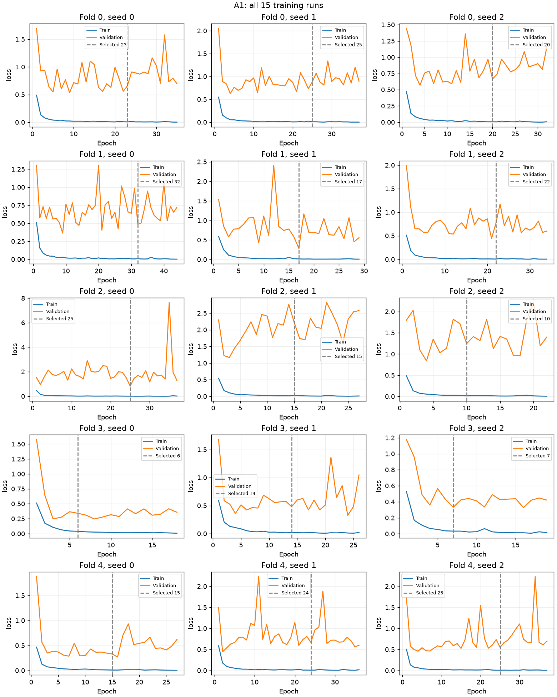
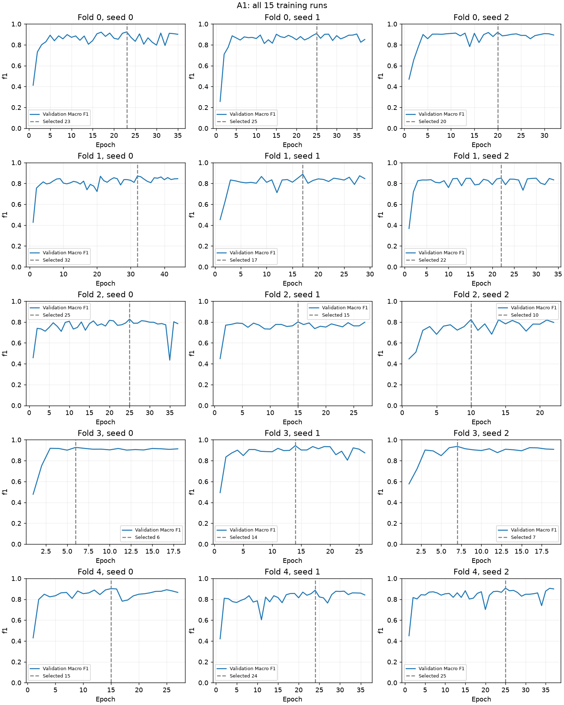
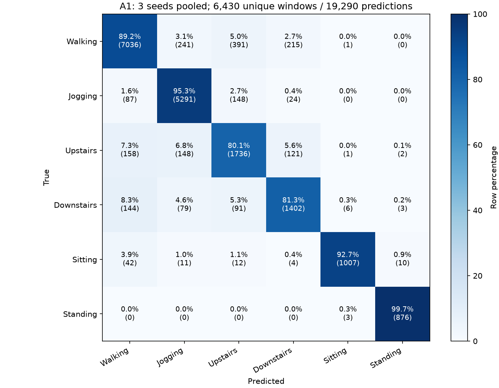

# WISDM A1 연구보고서 — A0 + residual

## 1 연구 질문과 결과

같은 폭과 깊이에서 residual 연결 추가의 효과를 확인한다. 개발 사용자 독립 검증 Macro F1은 **0.8881 ± 0.0461**, Accuracy는 **0.8982**다. 최종 테스트 성능이 아니다.

A0 대비 평균 -0.49%p, 1/5 fold 상승: **사전 기준으로 구별 불가**. 사용자별 평균 정확도는 12명 상승, 16명 하락, 2명 동일하다.

## 2 데이터와 평가 설계

WISDM v1.1 raw의 36명, 6개 행동, 약 20 Hz 3축 가속도 데이터다. timestamp 0·완전 중복·연속 동일 사용자/행동/시각의 뒤 레코드를 제외하고, 사용자/행동 변경·파싱 실패·시간 역행·1초 초과 공백에서 구간을 끊는다. 128시점 미만 구간은 제외한다. 정제 후 424개 구간, 비중첩 윈도우 7,841개다.

테스트 사용자 [6, 21, 24, 27, 29, 34]의 1,411개 윈도우를 보류했다. 개발 30명에서 매 fold 학습 24명·검증 6명을 분리한다. 입력은 128×3, 학습 stride 64·검증 stride 128이다. 표준화 통계는 해당 fold 학습 사용자에게서만 계산한다. 6,430개 고유 검증 윈도우를 seed별로 반복하므로 총 예측 19,290건은 독립 표본 19,290개가 아니다.

| fold | 검증 사용자 | 검증 윈도우 |
| --- | --- | --- |
| 0 | 1, 7, 20, 22, 25, 36 | 1340 |
| 1 | 9, 16, 19, 26, 28, 33 | 1109 |
| 2 | 2, 3, 4, 14, 30, 31 | 1332 |
| 3 | 8, 10, 11, 12, 13, 15 | 1468 |
| 4 | 5, 17, 18, 23, 32, 35 | 1181 |

## 3 모델과 학습

구조는 **A0 + residual**이며 총 파라미터는 **84,870개**다. 블록의 두 합성곱이 입력 x를 변환한 결과를 F(x)라고 하자. A0의 ReLU(F(x))가 A1에서는 ReLU(F(x)+x)가 된다. 두 경로 모두 시간 길이와 64채널을 유지해 같은 위치의 값을 더할 수 있다. 덧셈에 새 가중치가 필요하지 않아 두 모델은 모두 84,870개 파라미터를 갖는다. 손실의 기울기가 입력으로 직접 전달되는 경로를 하나 추가한 셈이다. 이 실험에서는 같은 검증 사람끼리 성능과 선택 epoch를 비교해 이 변화의 영향을 읽는다. [모델 구현](../04_A1_ResNet_5fold.ipynb)

Adam(0.001), sparse categorical cross entropy, batch 64, Dropout 0.4, 최대 100 epoch, 검증 Macro F1 patience 12로 학습하고 최고 epoch 가중치를 복원했다. TensorFlow 2.21.0, NumPy 2.4.6, Colab T4 GPU를 사용했다. 5-fold × seed 0·1·2의 독립 학습 15회다.

model.fit 시간 합계 683.3초, 평균 45.6초다. 데이터 전송·정제·저장 시간은 제외한다. 선택 epoch 범위는 6~32, 종료 epoch 범위는 18~44다.

점선은 검증 Macro F1이 가장 높아 가중치를 보존한 epoch다. 선택 epoch의 중앙값은 A1에서 20회, 비교 대상 A0에서 13회였다. A1의 선택 시점에서 15회 훈련 loss의 중앙값은 0.009, 검증 loss의 중앙값은 0.658였다. Loss는 실제 행동에 얼마나 높은 확률을 줬는지 반영한다. 맞힌 행동의 개수가 같아도 틀린 행동에 확신이 높으면 loss가 클 수 있다.

## 4 전체 분류지표

seed 3개를 fold 안에서 평균하고, fold 5개의 평균과 표본 표준편차를 제시한다. 표준편차는 신뢰구간이 아니다. Precision은 예측 행동의 정밀도, Recall은 실제 행동의 검출률, F1은 두 값의 조화평균이다. Macro는 행동별 동일 가중치, Weighted F1은 실제 표본 수 가중치다.

| 지표 | fold 평균 | fold 표준편차 |
| --- | --- | --- |
| Accuracy | 0.8982 | 0.0398 |
| Macro Precision | 0.8985 | 0.0290 |
| Macro Recall | 0.8898 | 0.0600 |
| Macro F1 | 0.8881 | 0.0461 |
| Weighted F1 | 0.9001 | 0.0402 |

## 5 행동별 지표와 혼동행렬

Precision·Recall·F1은 15회 지표 평균이며 표본 수는 seed 중복을 제외한 고유 윈도우다. 평균 F1이 가장 낮은 행동은 Upstairs(0.7587), 가장 높은 행동은 Standing(0.9900)다.

| 행동 | Precision | Recall | F1 | 고유 윈도우 |
| --- | --- | --- | --- | --- |
| Walking | 0.9416 | 0.8921 | 0.9153 | 2628 |
| Jogging | 0.9259 | 0.9438 | 0.9326 | 1850 |
| Upstairs | 0.7452 | 0.7937 | 0.7587 | 722 |
| Downstairs | 0.8126 | 0.8087 | 0.7994 | 575 |
| Sitting | 0.9821 | 0.9036 | 0.9322 | 362 |
| Standing | 0.9835 | 0.9969 | 0.9900 | 293 |

행은 실제, 열은 예측이다. 비율은 행 기준이며 괄호는 seed 3개 합산 건수다. 행동별 평균 Recall과 합산 행 비율은 집계 방식이 다르다. 아래 오류 방향의 원인을 센서 방향·걸음걸이 등 특정 요인으로 단정하지 않는다.

| 실제 | 예측 | 오류 건수 |
| --- | --- | --- |
| Walking | Upstairs | 391 |
| Walking | Jogging | 241 |
| Walking | Downstairs | 215 |
| Upstairs | Walking | 158 |
| Upstairs | Jogging | 148 |

**구조 변경 뒤 어떤 행동을 더 자주 찾아냈는가?** 아래 값은 같은 검증 사용자에서 얻은 15회 Recall의 평균이다. 차이가 가장 큰 행동은 Walking (+0.83%p), 가장 작은 행동은 Downstairs (-3.20%p)다.

| 행동 | A0 Recall | A1 Recall | 차이 (%p) |
| --- | --- | --- | --- |
| Walking | 0.8839 | 0.8921 | +0.83 |
| Jogging | 0.9695 | 0.9438 | -2.57 |
| Upstairs | 0.7967 | 0.7937 | -0.31 |
| Downstairs | 0.8406 | 0.8087 | -3.20 |
| Sitting | 0.9079 | 0.9036 | -0.43 |
| Standing | 0.9958 | 0.9969 | +0.10 |

## 6 fold·seed·사용자 분석

| fold | Accuracy | Macro F1 | seed F1 표준편차 |
| --- | --- | --- | --- |
| 0 | 0.9147 | 0.9174 | 0.0080 |
| 1 | 0.8825 | 0.8703 | 0.0188 |
| 2 | 0.8381 | 0.8179 | 0.0147 |
| 3 | 0.9430 | 0.9360 | 0.0083 |
| 4 | 0.9125 | 0.8987 | 0.0108 |

사용자 동일 가중치 평균 Accuracy는 0.8714다. 아래는 낮은 6명이며, 전체 30명은 [A1_users_summary.csv](A1_users_summary.csv)에 있다. 낮은 점수 때문에 사용자를 제외하지 않는다.

| 사용자 | 윈도우 | Accuracy | seed 표준편차 |
| --- | --- | --- | --- |
| 30 | 181 | 0.3112 | 0.1634 |
| 25 | 103 | 0.4078 | 0.0000 |
| 9 | 99 | 0.4714 | 0.0997 |
| 17 | 166 | 0.5562 | 0.0251 |
| 2 | 180 | 0.7444 | 0.0747 |
| 12 | 238 | 0.7829 | 0.0216 |

## 7 구조 비교와 판정

| 비교 대상 | fold | 참조 F1 | 현재 F1 | 차이 %p |
| --- | --- | --- | --- | --- |
| A0 | 0 | 0.9197 | 0.9174 | -0.23 |
| A0 | 1 | 0.8857 | 0.8703 | -1.54 |
| A0 | 2 | 0.8117 | 0.8179 | +0.61 |
| A0 | 3 | 0.9388 | 0.9360 | -0.29 |
| A0 | 4 | 0.9085 | 0.8987 | -0.98 |

A0 대비 평균 -0.49%p, 1/5 fold 상승: **사전 기준으로 구별 불가**. 사용자별 평균 정확도는 12명 상승, 16명 하락, 2명 동일하다.

평균 +0.5%p 및 4/5 fold 이상 상승은 사전 실용 규칙이며 통계적 유의성을 뜻하지 않는다. 구조 비교에서 파라미터 수와 수용 영역이 달라질 수 있다. CBAM과 SE는 채널 계산도 달라 둘의 차이가 시간 attention만의 효과는 아니다.

## 8 한계와 다음 단계

검증 fold를 조기 종료와 구조 비교에 함께 사용하므로 선택 편향이 있을 수 있다. fold의 학습 사용자들이 겹치고 seed도 같은 사용자 반복이어서 15개 독립 표본으로 검정하지 않는다. 전체 데이터 품질·라벨 분포를 살핀 뒤 분할했으나 보류 테스트 성능은 확인하지 않았다. 다른 기기·휴대 위치·실생활 동작 전환으로의 일반화는 검증하지 않았다.

다음 구조에서도 동일 분할과 설정을 유지해 사전 비교를 수행한다. 필수 7개 구조가 완료되면 Q1·Q2·Q3을 종합하고, CPU 추론시간과 경량화 판단을 보완한다. 파라미터 감소만으로 속도·전력 개선을 주장하지 않는다. 테스트를 보기 전에 후보와 최종 학습 epoch를 고정한다.

## 9 전체 실행 기록

| fold | seed | Accuracy | Macro F1 | 선택 epoch | 종료 epoch | 학습 초 |
| --- | --- | --- | --- | --- | --- | --- |
| 0 | 0 | 0.9179 | 0.9239 | 23 | 35 | 60.0 |
| 0 | 1 | 0.9060 | 0.9085 | 25 | 37 | 47.8 |
| 0 | 2 | 0.9201 | 0.9199 | 20 | 32 | 42.1 |
| 1 | 0 | 0.8756 | 0.8710 | 32 | 44 | 58.6 |
| 1 | 1 | 0.9098 | 0.8888 | 17 | 29 | 39.7 |
| 1 | 2 | 0.8620 | 0.8513 | 22 | 34 | 45.3 |
| 2 | 0 | 0.8589 | 0.8282 | 25 | 37 | 58.3 |
| 2 | 1 | 0.8213 | 0.8010 | 15 | 27 | 39.9 |
| 2 | 2 | 0.8341 | 0.8243 | 10 | 22 | 33.9 |
| 3 | 0 | 0.9421 | 0.9272 | 6 | 18 | 33.4 |
| 3 | 1 | 0.9435 | 0.9438 | 14 | 26 | 38.8 |
| 3 | 2 | 0.9435 | 0.9369 | 7 | 19 | 31.5 |
| 4 | 0 | 0.9128 | 0.9023 | 15 | 27 | 44.8 |
| 4 | 1 | 0.9035 | 0.8865 | 24 | 36 | 49.9 |
| 4 | 2 | 0.9213 | 0.9072 | 25 | 37 | 59.3 |

## 10 재현 자료

- [연구계획서](../연구계획서.md), [실행계획](../실행계획_1단계.md), [데이터 출처 설명](../artifacts/source_descriptions.json)
- [실행별 기록](../runs/A1_runs.csv), [사용자별 기록](../runs/A1_users.csv), [프로토콜·데이터 해시](../runs/A1_progress.json)
- [전체 지표](A1_classification_runs.csv), [행동별 지표](A1_classification_by_class.csv), [혼동행렬 건수](A1_confusion_counts.csv)
- 실행별 예측·표준화 값은 `runs/A1_fold{fold}_seed{seed}_predictions.npz`, 학습 곡선은 같은 접두사의 `_history.csv`다. 가중치는 PC와 Drive에 보존한다.
- 보고서 계산 코드는 [report_cnn.py](../scripts/report_cnn.py)다. 저장 지표, 사용자별 정확도, 학습 곡선의 최적 epoch, A0와 동일 검증 표본 및 표준화 값을 검사한 후 작성한다.
