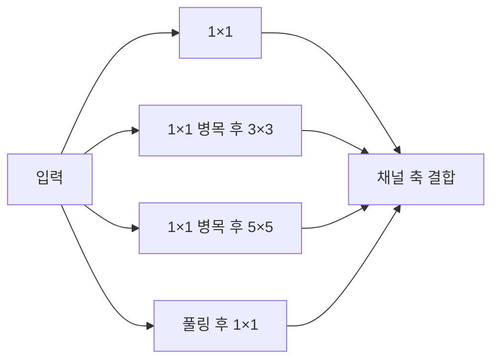

# 1. GoogLeNet / Inception Module

[FAQ 목차로 돌아가기](../README.md)

## 한 입력을 네 가지로 보는 과정

GoogLeNet의 이미지용 블록을 단순화한 그림이다. 네 출력의 높이와 너비가 같고 채널 수가 각각 16이라면 결합 결과는 64채널이다. 같은 자리에 있던 네 숫자를 더하는 연산과 결과 크기가 다르다.

### 1. Inception 모듈은 무엇인가?

하나의 입력 특징 맵을 여러 분기로 보내고, 각 분기의 출력을 채널 방향으로 이어 붙이는 블록이다. 원래 GoogLeNet은 크기가 다른 합성곱과 pooling 분기를 한 블록에 넣었다.

### 2. Inception 모듈에서 여러 크기의 convolution filter를 병렬로 사용하는 이유는 무엇인가?

작은 필터는 좁은 이웃의 변화를, 큰 필터는 더 넓은 문맥을 한 번에 볼 수 있다. 어느 범위가 필요한지 미리 한 가지로 정하지 않고 같은 층에서 서로 다른 범위의 반응을 다음 층에 전달한다.

### 3. (1 × 1), (3 × 3), (5 × 5) convolution을 동시에 사용하는 장점은 무엇인가?

1×1은 같은 위치의 채널 조합, 3×3은 가까운 이웃, 5×5는 더 넓은 이웃을 처리한다. stride와 padding을 맞춰 공간 크기를 유지하면 같은 위치에서 나온 세 종류의 특징을 모아 쓸 수 있다.

### 4. 이미지나 feature map에서 다양한 scale의 정보를 추출해야 하는 이유는 무엇인가?

이미지에서는 바퀴 테두리의 짧은 곡선과 바퀴 전체의 형태가 다른 크기로 나타난다. 가속도 신호에서도 순간 충격과 반복되는 보행 리듬은 시간 폭이 다르다. 앞선 층을 거치면 같은 kernel 크기도 원래 입력에서 보는 범위가 달라진다.

### 5. Inception 모듈에서 1 x 1 convolution은 어떤 역할을 하는가?

비용이 큰 합성곱 앞에서 채널을 줄이는 병목으로 쓰고, 독립 분기나 pooling 뒤에서 채널을 조합하는 데도 쓴다. stride 1이면 높이와 너비는 그대로다.

### 6. 1 x 1 convolution이 연산량을 줄이는 원리는 무엇인가?

예를 들어 입력·출력이 각 64채널이면 5×5 필터 가중치는 102,400개다. 먼저 1×1로 16채널을 만들면 $64×16+25×16×64=26,624$개다. 편향을 제외한 값이며 같은 출력 해상도에서는 위치당 곱셈 수도 같은 비율로 줄어든다.

### 7. 1 x 1 convolution이 크기 축소와 함께 channel mixing을 수행한다는 말은 무슨 뜻인가?

한 위치의 RGB가 (2, 3, 5)이고 한 출력 필터의 가중치가 (1, 0, −1)이면 출력은 −3이다. 이처럼 같은 위치의 채널들을 가중합해 새 채널을 만든다. 출력 필터를 몇 개 두느냐에 따라 채널 수가 결정된다.

### 8. GoogLeNet이 깊은 네트워크임에도 파라미터 수를 상대적으로 줄일 수 있었던 이유는 무엇인가?

큰 필터 앞의 1×1 병목으로 입력 채널 수를 제한했고, 마지막에는 전역 평균 풀링으로 특징 맵을 요약해 큰 완전연결층의 부담을 줄였다. 병렬 분기마다 폭을 정한 점도 전체 예산을 맞추는 데 중요하다.

### 9. Inception 구조와 일반적인 sequential CNN 구조의 차이는 무엇인가?

순차형 CNN에서는 한 층의 출력 전체가 다음 층으로 넘어간다. Inception에서는 같은 입력에서 여러 연산이 출발하고, 출력들을 이어 붙인 뒤 다음 블록으로 넘어간다. 분기 출력을 더하는 ResNet의 연산과도 구별된다.

### 10. Inception 모듈의 장점과 한계는 무엇인가?

여러 규모의 특징을 한 블록에서 얻고 분기 폭으로 비용을 조절할 수 있다. 반면 분기마다 필터 크기와 채널 수를 설계해야 하며, 장치에 따라 분기 실행 비용이 커질 수 있다. 우리 A2는 이미지용 원형을 1D kernel 3·7·15로 바꿔 비교했다.

## 복습할 때 확인할 점

병목 계산에서 64→16으로 줄인 것은 시간 길이일까, 채널 수일까? 위 식의 각 수가 무엇을 세는지 확인해 본다.

[WISDM 실험의 구조별 비교](../../9week/reports/10_1단계_개발_검증_종합.md) · [구조 제안 논문](https://arxiv.org/abs/1409.4842)
