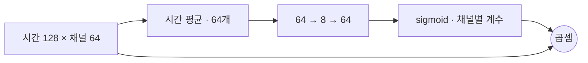

# 2. SENet / SE Block

[FAQ 목차로 돌아가기](../README.md)

## 채널 계수는 어디에서 오는가

WISDM B2의 첫 번째 블록에서 채널 $c$의 평균은 $z_c=\frac{1}{128}\sum_{t=1}^{128}x_{t,c}$다. 이 평균들을 이용해 만든 계수 $s_c$를 모든 시점에 곱한다. 출력 $y_{t,c}=s_c x_{t,c}$의 크기는 여전히 128×64다.

### 1. SENet이 해결하려고 한 문제는 무엇인가?

기본 합성곱에서 학습한 필터는 모든 입력에 같은 가중치를 쓴다. SENet은 현재 샘플에서 어떤 채널의 반응을 상대적으로 더 살릴지 판단하는 경로를 추가했다.

### 2. CNN에서 channel이 의미하는 것은 무엇인가?

입력에서는 RGB나 x·y·z처럼 측정 성분 하나가 채널이다. 합성곱 뒤에서는 한 필터가 여러 위치에서 낸 반응의 모음이 한 출력 채널이다. 중간 채널마다 사람이 붙일 수 있는 의미가 반드시 있는 것은 아니다.

### 3. 모든 channel이 동일하게 중요한 것은 아니라는 말은 무슨 의미인가?

같은 필터라도 걷기 구간과 정지 구간에서 분류에 기여하는 정도가 달라질 수 있다. SE는 현재 입력의 요약값을 보고 채널마다 다른 계수를 계산한다.

### 4. SE block에서 Squeeze 단계는 무엇을 수행하는가?

각 채널을 공간 전체에서 평균해 채널당 숫자 하나로 줄인다. 이미지의 H×W×C가 길이 C의 벡터가 되고, 시계열 T×C에서는 T개 시점에 대해 평균한다.

### 5. SE block에서 Global Average Pooling, 즉 GAP의 역할은 무엇인가?

GAP은 채널 반응을 한 값으로 요약해 입력 전체의 상황을 가중치 계산에 제공한다. 예를 들어 네 시점의 값이 0, 2, 4, 2라면 그 채널의 요약값은 2다.

### 6. GAP을 사용하면 feature map의 어떤 정보가 압축되는가?

공간 크기나 시점 수가 요약 벡터에서 사라진다. 예를 들어 0, 4와 4, 0은 모두 평균 2이므로 어느 위치에서 먼저 반응했는지는 GAP만으로 복원하기 어렵다.

### 7. SE block에서 Excitation 단계는 어떻게 작동하는가?

채널 요약 벡터를 작은 은닉층으로 줄여 ReLU를 적용하고 다시 원래 채널 수로 늘린다. 마지막 sigmoid의 출력이 채널별 계수다. 우리 B2의 경우 64→8→64였다.

### 8. Excitation에서 fully connected layer와 sigmoid를 사용하는 이유는 무엇인가?

완전연결층은 여러 채널의 요약값을 함께 보므로 한 채널의 가중치가 다른 채널의 상태에도 의존한다. sigmoid는 각 계수를 독립적으로 0~1 사이로 제한한다. 모든 계수의 합을 1로 맞출 필요가 없다.

### 9. SE block은 각 channel에 어떤 방식으로 가중치를 부여하는가?

채널 c의 계수가 0.8이면 그 채널의 모든 위치에 0.8을 곱한다. 원래 반응이 5라면 4가 된다. ‘강조’는 작은 계수를 받은 다른 채널에 비해 상대적으로 더 유지된다는 뜻이다.

### 10. SE block이 channel attention이라고 불리는 이유는 무엇인가?

입력에 따라 다시 계산되는 가중치의 축이 채널이기 때문이다. 출력 채널 수는 유지되고, 샘플마다 채널 간 반영 비율이 달라진다.

### 11. SE block은 spatial 위치 정보보다 어떤 정보에 더 집중하는가?

구간 전체를 볼 때 어떤 종류의 특징이 유용한지에 집중한다. 같은 채널 안의 두 시점에는 같은 계수가 곱해지므로 특정 시점만 골라 누르는 기능은 제한된다.

### 12. SE block을 기존 CNN에 쉽게 삽입할 수 있는 이유는 무엇인가?

재가중한 출력은 입력과 공간·채널 크기가 같다. 따라서 기존 블록 출력에 붙인 뒤 다음 층을 그대로 연결할 수 있다. 우리 B2에서는 residual 경로 끝에서 재가중한 뒤 지름길과 더했다.

### 13. SE block이 성능을 향상시키는 핵심 원리는 무엇인가?

SE는 서로 다른 입력에 서로 다른 채널 계수를 적용한다. 현재 행동을 구분하는 데 유용한 채널을 상대적으로 더 남기면 분류에 도움이 될 수 있다.

### 14. SE block의 한계는 무엇인가?

평균 과정에서 짧은 강한 반응이 희석될 수 있고, 채널 계수를 만드는 학습 비용도 추가된다. 실제 WISDM에서 B2−B1의 개발 Macro F1은 −0.38%p여서 SE 추가의 개선을 확인하지 못했다.

## 복습할 때 확인할 점

128×64 특징을 squeeze하면 몇 개의 값이 남을까? 계수를 곱한 뒤에는 왜 다시 128×64가 되는지 설명해 본다.

[WISDM 실험의 구조별 비교](../../9week/reports/10_1단계_개발_검증_종합.md) · [구조 제안 논문](https://arxiv.org/abs/1709.01507)
