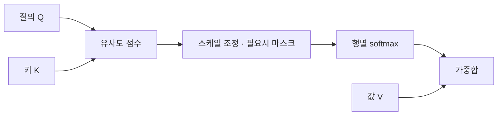

# 6. Transformer / CNN 변형 모델 이해 확인 질문

[FAQ 목차로 돌아가기](../README.md)

## 어떤 토큰의 값을 얼마나 가져오는가

$$
\mathrm{Attention}(Q,K,V)=\mathrm{softmax}\!\left(\frac{QK^\top}{\sqrt{d_k}}+M\right)V
$$

$d_k$는 키 벡터의 차원이다. 인과 마스크 $M$은 허용한 위치에서 0, 미래 위치에서 $-\infty$다. 예를 들어 한 질의의 가중치가 (0.75, 0.25)이고 두 값이 2, 6이면 출력은 $0.75\times2+0.25\times6=3$이다.

### 0. Self Attention, Cross Attention, Scaled Dot-Product Attention, Multi-Head Attention 이란?

- **Self-attention**은 같은 시퀀스에서 질의 Q, 키 K, 값 V를 만든다. 각 토큰은 자신의 질의와 다른 위치를 포함한 키들을 비교해 필요한 값을 모은다.
- **Cross-attention**은 질의와 키·값을 서로 다른 시퀀스에서 가져온다. 번역에서는 디코더 상태가 질의가 되고 원문의 인코더 출력이 키와 값의 바탕이 된다.
- **Scaled dot-product attention**은 위 수식처럼 질의와 키의 내적을 $\sqrt{d_k}$로 나눠 softmax에 넣는다. 차원이 커질 때 내적이 지나치게 커져 가중치가 한쪽에 쏠리는 현상을 완화한다.
- **Multi-head attention**은 서로 다른 투영 행렬로 여러 묶음의 Q·K·V를 만들어 attention을 계산한다. 각 head의 출력을 이어 붙여 한 번 더 투영한다.

### 1. Positional Encoding은 어떻게 구현하나?

원래 Transformer는 모델 차원 $d$와 토큰 위치 $p$로 각도 $p/10000^{2i/d}$를 계산한다. 차원 $2i$에는 이 각도의 sin, 바로 다음 차원 $2i+1$에는 cos를 넣는다. 길이 N의 입력에서 표의 앞 N행을 가져와 같은 크기 N×d의 토큰 임베딩에 더한다. 위치별 벡터를 학습하는 방법도 있으며, ViT 원형은 학습 가능한 위치 임베딩을 쓴다.

### 2. Look-ahead mask는 왜 사용하는가?

자기회귀 디코더가 다음 토큰을 예측할 때 미래의 정답을 미리 참조하면 학습과 생성 조건이 달라진다. 그래서 위치 i에서 j>i인 점수를 softmax 전에 음의 무한대로 바꾼다. 미래 위치의 가중치는 0이 되고 앞쪽 토큰은 함께 볼 수 있다.

### 3. CNN과 Transformer의 가장 큰 구조적 차이는 무엇인가?

CNN은 가까운 위치들에 같은 필터를 반복 적용한다. 기본 Transformer는 토큰 쌍의 내용에 따라 attention 가중치를 계산한다. CNN의 필터는 학습 후 고정되고, attention 가중치는 새 입력마다 달라진다.

### 4. CNN은 local receptive field를 기반으로 한다. 이것이 의미하는 바는 무엇인가?

한 층의 한 출력값이 입력의 제한된 이웃에 의존한다는 뜻이다. stride 1인 kernel 3 합성곱 두 층을 겹치면 이론적 수용 영역은 한 축에서 3에서 5로 커진다.

### 5. Transformer의 self-attention은 CNN의 convolution과 비교했을 때 어떤 장점이 있는가?

전역 self-attention에서는 멀리 떨어진 두 토큰도 한 층에서 직접 연결될 수 있다. 이미지 양쪽의 패치가 같은 물체의 일부인지 판단할 때 긴 합성곱 경로를 거치지 않고 정보를 교환할 수 있다.

### 6. Vision Transformer에서 이미지를 patch로 나누는 이유는 무엇인가?

픽셀마다 토큰을 만들면 쌍별 점수 행렬이 너무 커진다. 224×224 이미지를 16×16 비중첩 패치로 나누면 패치 토큰은 14×14=196개다. 분류 토큰을 쓰는 경우 한 개가 더 붙는다.

### 7. Patch embedding은 CNN의 convolution과 어떤 점에서 유사한가?

각 패치를 펼쳐 같은 선형층으로 투영하는 연산은 kernel 크기와 stride를 모두 패치 한 변 P로 둔 합성곱과 같은 형태이다. 한 필터가 한 패치 전체와 모든 입력 채널을 보고 임베딩 성분 하나를 만든다.

### 8. Transformer는 왜 positional encoding이 필요한가?

위치 단서가 없는 self-attention은 입력 토큰의 순서를 바꾸면 출력도 같은 순서로 바뀐다. 따라서 패치가 이미지의 왼쪽 위에 있었는지, 단어가 앞에 나왔는지를 구분할 단서를 위치 표현으로 제공한다.

### 9. CNN은 위치 정보를 어떻게 자연스럽게 반영하는가?

합성곱 kernel의 왼쪽 가중치와 오른쪽 가중치는 서로 다른 상대 위치를 담당한다. 이 패턴을 전체 입력에 공유하므로 위치가 옮겨져도 비슷한 패턴에 반응한다. 절대 좌표를 자동으로 안다는 뜻은 아니며 padding이나 stride에 따라 이동 성질도 달라진다.

### 10. Transformer는 global dependency를 잘 포착하지만, CNN보다 부족할 수 있는 점은 무엇인가?

기본 전역 attention은 가까운 점끼리 먼저 묶는 구조적 가정이 약하고, 토큰 수 N에 대해 점수 행렬에 N²개 항이 생긴다. 고해상도 이미지나 작은 학습셋에서는 이 비용과 학습 부담이 중요해진다.

### 11. CNN-Transformer hybrid 모델이 등장한 이유는 무엇인가?

이미지에는 가까운 픽셀끼리 만든 질감과 멀리 떨어진 부분 간 관계가 모두 있다. 앞부분은 합성곱으로 지역 특징을 만들고 뒷부분은 attention으로 긴 범위의 관계를 다루는 설계가 자연스럽다.

### 12. CNN과 Transformer를 결합하면 어떤 장점을 기대할 수 있는가?

CNN에서 해상도를 줄인 뒤 attention을 쓰면 토큰 수를 낮추면서 넓은 문맥을 결합할 수 있다. 대신 다운샘플링에서 잃은 세부 정보는 뒷단에서 다시 얻기 어려워 어느 단계에서 결합할지가 중요하다.

### 13. CNN backbone 뒤에 Transformer encoder를 붙이는 구조는 어떤 목적을 가지는가?

예를 들어 CNN 출력이 14×14×C이면 196개 위치의 특징 벡터로 펼쳐 encoder에 넣는다. 위치 표현을 더하고 토큰끼리 정보를 주고받게 하면 국소 특징에 이미지 전체 문맥이 반영된다.

### 14. Transformer 기반 vision 모델에서도 convolution이나 local window attention을 사용하는 이유는 무엇인가?

합성곱은 이웃 관계를 효율적으로 반영하고, window attention은 비교할 토큰을 가까운 창으로 제한한다. 입력이 커져도 각 층에서 처리할 쌍의 수를 줄일 수 있다.

### 15. Swin Transformer에서 window attention을 사용하는 이유는 무엇인가?

한 창에 M개의 토큰이 있고 전체가 N개면 창 내부 점수 수는 대략 NM개다. 창 크기를 고정하면 N에 선형으로 늘어난다. 다음 블록에서 창을 이동시키면 이전에 다른 창에 있던 이웃도 정보를 교환한다.

### 16. ConvNeXt는 Transformer의 설계 철학을 CNN에 반영한 모델이다. 이런 접근이 의미하는 바는 무엇인가?

ConvNeXt는 계층 구성, 큰 kernel의 depthwise 합성곱, LayerNorm 등 설계와 학습 방식을 현대화한 CNN이다. Transformer 시대의 성능 향상 중 어느 부분을 합성곱 기반에서도 얻을 수 있는지 비교했다는 데 의미가 있다.

### 17. CNN의 inductive bias란 무엇인가?

Inductive bias는 새 데이터에도 통할 규칙을 고를 때 모델 구조가 미리 선호하는 가정이다. CNN은 가까운 입력끼리 관련되고, 한 위치에서 발견한 패턴이 다른 위치에서도 쓸모 있다는 가정을 지역 필터와 가중치 공유로 구현한다.

### 19. Transformer는 CNN보다 inductive bias가 약하다고 말하는 이유는 무엇인가?

기본 전역 Transformer에서는 거리가 먼 두 토큰도 처음부터 연결할 수 있어 어느 이웃이 중요한지 데이터로 배울 여지가 크다. 토큰별 가중치 공유나 위치 표현 같은 가정은 여전히 있으며 Swin처럼 지역성을 강화한 변형도 있다.

### 20. 데이터가 적은 경우 CNN이 Transformer보다 유리할 수 있는 이유는 무엇인가?

데이터가 적을 때 지역성과 가중치 공유가 과제와 잘 맞으면 같은 패턴을 위치마다 따로 배울 필요가 줄어든다. 이 경우 제한된 예시로도 일반화하기 쉽다. 사전학습 여부와 증강 조건도 비교 결과에 영향을 준다.

### 21. 데이터가 충분히 큰 경우 Transformer가 강력한 성능을 보일 수 있는 이유는 무엇인가?

다양한 예시와 충분한 계산량이 있으면 입력별로 달라지는 먼 거리 관계를 학습할 기회가 많아진다. 대규모 사전학습 뒤 목표 과제에 적응시키는 방식이 대표적이다. 이번 WISDM 연구에서는 CNN 조합을 비교했으므로 Transformer의 성능은 별도 실험 질문으로 남는다.

## 복습할 때 확인할 점

패치 한 변을 16에서 8로 줄이면 패치 토큰 수와 전역 attention 점수 행렬의 원소 수는 각각 몇 배가 될까? 분류 토큰은 제외한다.

[수업의 CNN–Transformer 결합 코드](https://github.com/MyungKyuYi/AI-class/blob/fe508cd0fdc46572dd300c0cb7b6f4346486b4b6/Resnet_Transformer.py) · [ViT](https://arxiv.org/abs/2010.11929) · [Swin](https://arxiv.org/abs/2103.14030) · [ConvNeXt](https://arxiv.org/abs/2201.03545) · [Transformer 논문](https://arxiv.org/abs/1706.03762)
